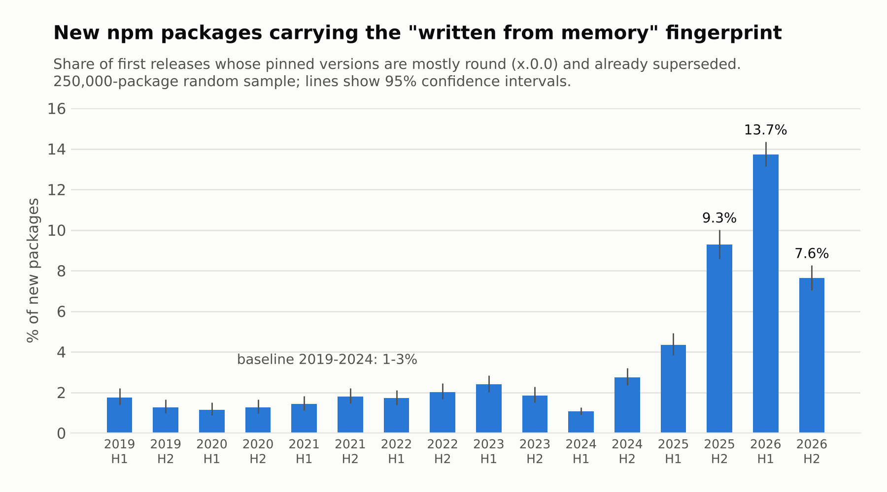
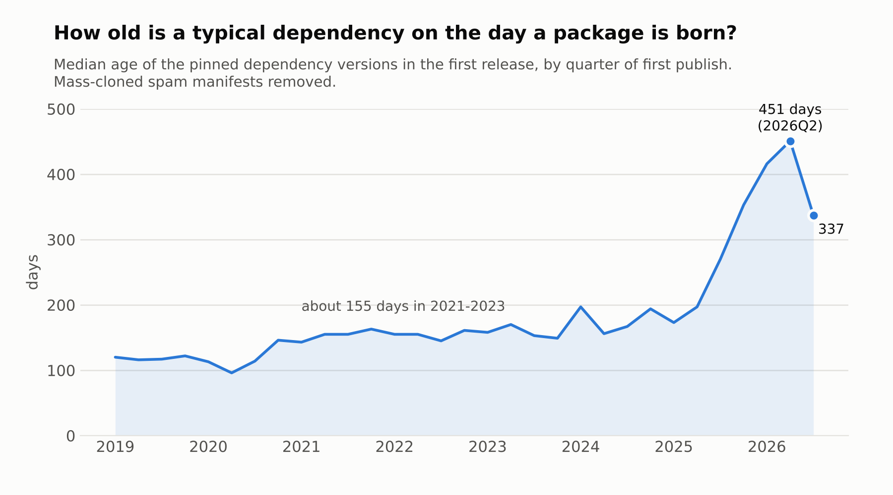
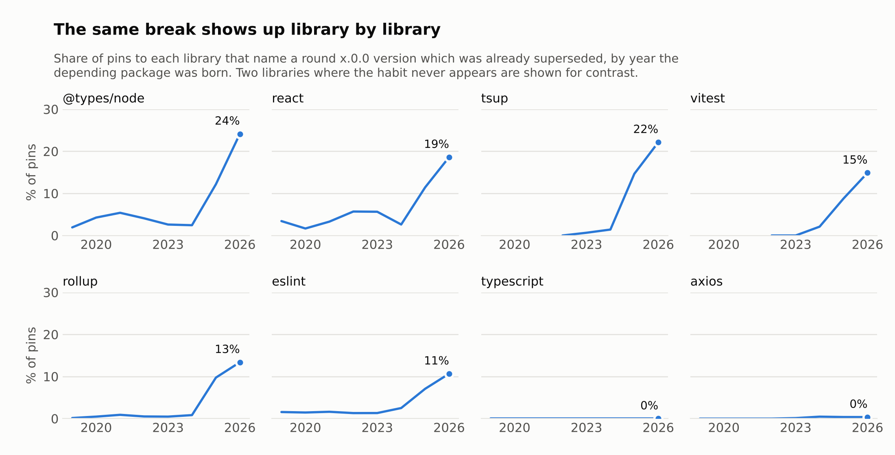
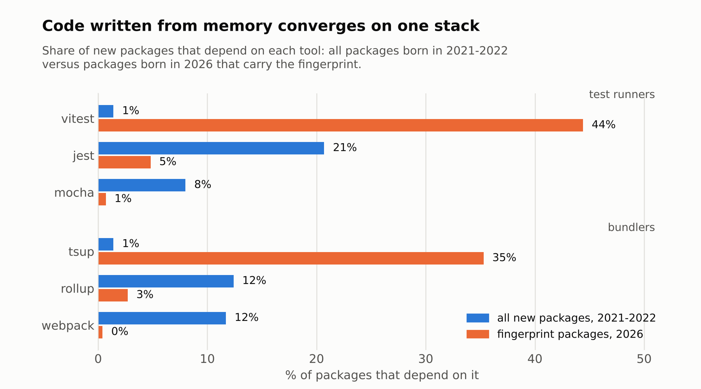

# Fossil versions

**A fingerprint of code written from an AI model's memory, measured across the npm registry.**

Kobi Mozgori · November 2026

## Summary

I sampled 250,000 npm packages at random and looked at the dependency versions each one named in its very first release.

- **A simple fingerprint went from background noise to one new package in seven.** Packages whose pinned versions are mostly round numbers (`x.0.0`) that were already out of date made up between 1% and 2.4% of new packages in every half-year from 2019 to early 2024. In the first half of 2026 they made up 13.7% (95% CI 13.1–14.4). "New packages" here means first releases with at least three datable pins.
- **New packages are born much staler than they used to be.** The typical pinned dependency was about 155 days old on the day a package was born in 2021–2023. In the second quarter of 2026 it was 451 days old.
- **Few packages are born up to date any more.** About 28% of new packages had essentially all their pins on the newest release in 2021–2023. In 2026 it is about 10%.
- **The fingerprint is fading.** Its share so far in the second half of 2026 (July to early November) is 7.6%, while staleness has fallen only a little.

The data cannot prove who or what wrote any single package. The timing, the specific versions involved, and the way package managers work all point to manifests written from a language model's memory rather than by running an install.



## Why round, stale versions are a tell

When a developer runs `npm install vitest`, npm writes the exact newest version into `package.json`, for example `"vitest": "^4.1.10"`. Nobody types that number. It is whatever was current that minute.

A manifest that says `"vitest": "^2.0.0"` a year and a half after 2.0.0 was superseded was not produced that way. Someone, or something, wrote the number down from memory. People have always done this occasionally, which is why the baseline is not zero. What changed in 2025 is how often it happens.

The versions involved are the giveaway. These are the most common round, already superseded pins in fingerprint packages born in 2026:

| Dependency | Version named | Released |
|---|---|---|
| tsup | 8.0.0 | Nov 2023 |
| @types/node | 20.0.0 | May 2023 |
| @types/node | 22.0.0 | Jul 2024 |
| react | 19.0.0 | Dec 2024 |
| vitest | 3.0.0 | Jan 2025 |
| vitest | 2.0.0 | Jul 2024 |
| @modelcontextprotocol/sdk | 1.0.0 | Nov 2024 |
| eslint | 9.0.0 | Apr 2024 |

Each is the first release of a major version, one to three years old on the day the package was published.

## Data and method

**Sample.** 250,000 names drawn uniformly at random (seed 11) from the 4,669,852 names in `all-the-package-names@2.0.2622`, fetched from the public npm registry on 12 November 2026. 246,072 still existed. 241,417 had a datable first release. 111,825 were born in 2016 or later and had at least three datable pins, and those are the packages analysed.

**First release only.** For every package I take the earliest published version and read its `dependencies`, `devDependencies` and `peerDependencies`. This captures the moment the manifest was first written, before any maintenance.

**Pins.** A pin is a range that names one concrete version: `^1.2.3`, `~1.2.3` or `1.2.3`. Open ranges, tags, git URLs and workspace references are ignored.

**Release timelines.** For the 4,000 most-used dependency names I fetched the publish time of every stable release. About 3,400 of them have stable releases. The 4,000 names account for roughly four in five dependency declarations in the sample.

**Measures, all taken on the day of the package's first release:**

- *Age* of a pin: days since the named version was published.
- *Superseded*: days since a higher version of the same dependency first appeared. Zero means the pin was the newest release.
- *Fingerprint*: at least two pins of the form `x.0.0` that had been superseded for 30 days or more, making up at least 40% of the package's pins.
- *Fresh*: at least 80% of pins were the newest release.

## Results

### Staleness at birth



| Born in | Packages | Fingerprint | Median pin age | Fresh at birth | Newest pin over a year old |
|---|---|---|---|---|---|
| 2023 H1 | 5,227 | 2.4% | 165 days | 27.6% | 12.7% |
| 2024 H2 | 5,671 | 2.7% | 177 days | 27.3% | 12.3% |
| 2025 H1 | 5,441 | 4.3% | 187 days | 22.9% | 16.8% |
| 2025 H2 | 6,318 | 9.3% | 314 days | 17.6% | 20.9% |
| 2026 H1 | 12,118 | 13.7% | 431 days | 11.8% | 27.7% |
| 2026 H2 (to early Nov) | 7,231 | 7.6% | 330 days | 8.8% | 21.6% |

Median pin age and fresh share are computed with mass-cloned spam manifests removed (see Robustness).

Within 2026, fingerprint packages are far staler than the rest. Their median pin is 675 days old and their *newest* pin is 422 days old. For other 2026 packages the figures are 335 and 43 days. For packages born in 2021–2022 they were 154 and 21 days.

The rest of 2026 is not a clean human baseline. Its median pin age has also doubled, which suggests the fingerprint catches only part of the manifests written from memory. A model that recalls `typescript ^5.7.2` leaves no round number behind.

### The same break, library by library



The share of pins that name a superseded `x.0.0` rose in 2025–2026 for `@types/node` (2–5% before, 24% in 2026), `react` (19%), `tsup` (22%), `vitest` (15%), `rollup` (13%) and `eslint` (11%). It stayed at zero for `typescript` and `axios`, where the round-number habit never appears.

### One stack



Fingerprint packages born in 2026 converge on a narrow set of tools. 44% depend on vitest and 5% on jest; among all packages born in 2021–2022 it was 1% and 21%. 35% depend on tsup; webpack and rollup, at 12% each in 2021–2022, are at 0.4% and 3%. Other 2026 packages show the same shift to a lesser degree, so part of this is simply the era.

### Registry growth

Scaling the sample up, about 374,000 packages were created in 2023, 455,000 in 2025 and 895,000 in 2026 up to 12 November. The 2024 figure (698,000) is inflated by a spam wave in the second quarter.

## Robustness

- **Definition.** A stricter rule (three or more stale round pins, at least half of all pins) gives 0.4–1.0% before 2024 and 7.7% in 2026 H1. Ignoring `peerDependencies`, where round ranges are a legitimate human convention, gives 12.9% in 2026 H1.
- **Spam.** In 2024 Q2 the registry was flooded with thousands of near-identical junk packages. Dropping every manifest whose exact set of pins occurs five or more times in the sample leaves the 2026 H1 figure at 13.6% and removes the 2024 dip.
- **Maintained packages only.** Restricting to packages with a repository field and at least two published versions gives 14.1% in 2026 H1.
- **Not one publisher.** The 3,038 fingerprint packages born in 2025–2026 were first published by 2,714 different accounts. The largest account is responsible for 0.4% of them.
- **Sampling error.** Half-year groups contain 3,900 to 13,500 packages. Confidence intervals are in `results/half_year.csv`.

### Alternative explanations

Three other things could produce round, stale pins at scale. The 2026 H1 figure (13.7%) barely moves under any of them. Every half-year is in `results/robustness.csv`.

- **Scaffolding tools.** `create-next-app` writes `react ^19.0.0`, so scaffolded apps could inflate the count. Dropping every package that depends on `next` or `react-dom` gives 13.4%. Ignoring all pins to `react`, `react-dom` and their type packages gives 12.8%.
- **A few popular templates.** Templates produce identical manifests. Among the 1,664 fingerprint packages born in 2026 H1, 87% have a manifest that no other sampled package shares, the same rate as all packages born in 2022 (86%). They contain 1,157 different combinations of round pins, and the ten most common combinations cover 13% of them. Dropping packages whose name or description says template, starter, boilerplate, scaffold, example or demo gives 13.8%.
- **Monorepos.** One repository can publish dozens of packages with the same manifest. Counting one package per npm scope gives 13.9%. Unscoped packages alone give 13.3% and scoped packages alone 14.0%.

Projects copied from an old repository cannot be ruled out package by package. Copying has always happened, though, and it is part of the 1–2.4% baseline. It would explain the jump only if what people copy had changed in 2025.

## Limits

- **Inference, not proof.** Nothing in registry metadata says who wrote a manifest. A person copying an old tutorial produces the same pattern. The claim rests on a baseline that was flat for six years and rose roughly eightfold in eighteen months.
- **An undercount of code written from memory, in an unknown amount.** Stale but non-round versions are not counted.
- **The decline since mid-2026 is unexplained.** It would fit coding agents resolving versions from the registry instead of reciting them. I did not test that.
- **npm only, first release only.** Other ecosystems and later releases may look different.
- **Coverage.** Pins to dependencies outside the 4,000 most-used names are not dated. Removed packages (1.6% of sampled names) are missing, and removal is not random.
- **One snapshot.** The sample was taken on one day. Packages published after the name list was built are absent, so the last quarter is thin.

## Related work

- Wang et al., [Correct Code, Vulnerable Dependencies](https://arxiv.org/abs/2605.06279) (May 2026), prompt ten models and measure the versions they specify in Python. This repository measures what was actually published.
- Decan, Mens and Constantinou, [On the evolution of technical lag in the npm package dependency network](https://arxiv.org/abs/1806.01545) (2018), define technical lag for npm before coding assistants existed.
- Microsoft, [Competing against yourself](https://developer.microsoft.com/blog/competing-against-yourself/) (June 2026), describes the same problem from a library vendor's side.

I searched for an earlier registry-scale measurement of this fingerprint and did not find one. If you know of one, please open an issue.

## Reproduce

```bash
pip install -r requirements.txt

# 1. the list of every package name (about 120 MB unpacked)
npm pack all-the-package-names@2.0.2622 && tar xzf all-the-package-names-2.0.2622.tgz

# 2. fetch the sample: 250,000 names, seed 11 (about 20 minutes)
python src/fetch_sample.py 250000 data/sample.jsonl 11 64

# 3. release timelines for the most-used dependencies (or: gunzip -k data/deps.jsonl.gz)
python src/fetch_deps.py data/top_dependencies.txt data/deps.jsonl

# 4. analysis and figures
python src/analyze.py
python src/charts.py
```

`data/sampled_names.txt.gz` lists the exact names drawn. Registry contents change, so a re-fetch will differ slightly for packages that were removed or republished.

## Files

| Path | Contents |
|---|---|
| `src/fetch_sample.py` | Draws the random sample and stores each package's first release |
| `src/fetch_deps.py` | Fetches release timelines for dependencies |
| `src/analyze.py` | Computes every number in this document |
| `src/charts.py` | Draws the figures |
| `results/` | CSV output: half-year, quarterly, robustness, per-library, stack, volume, top round pins |
| `data/` | Sampled names, dependency timelines, list of dependencies fetched |

## Notes

The analysis was carried out with Claude (Anthropic) as a research assistant. Code is MIT licensed.
